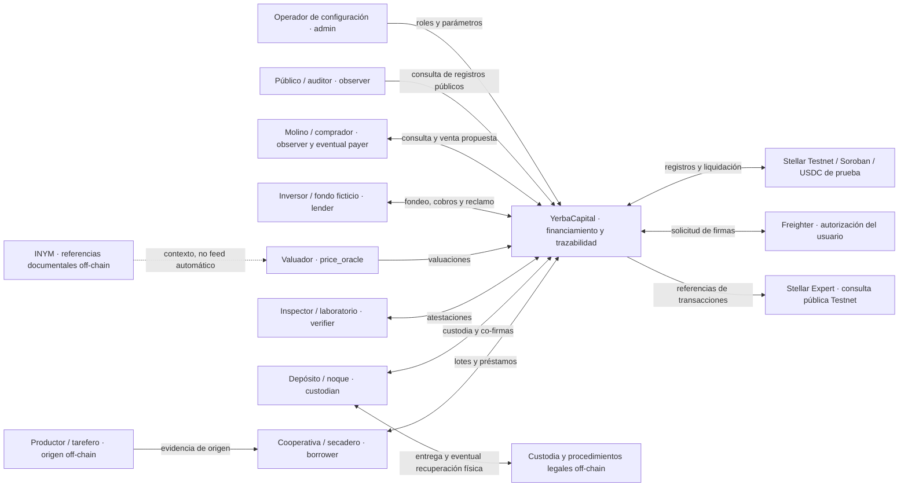
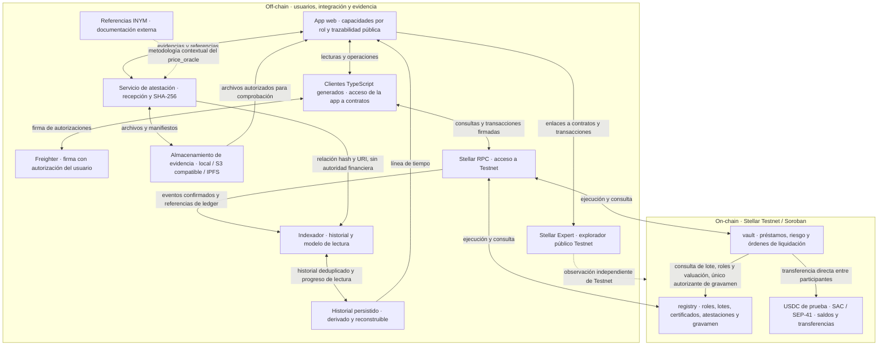
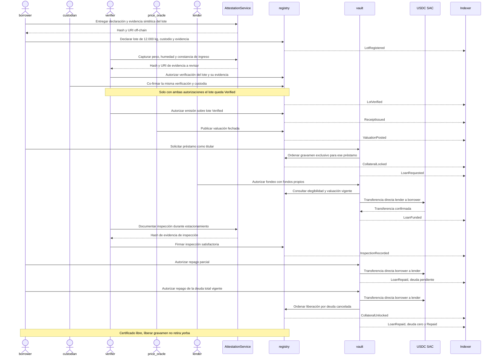
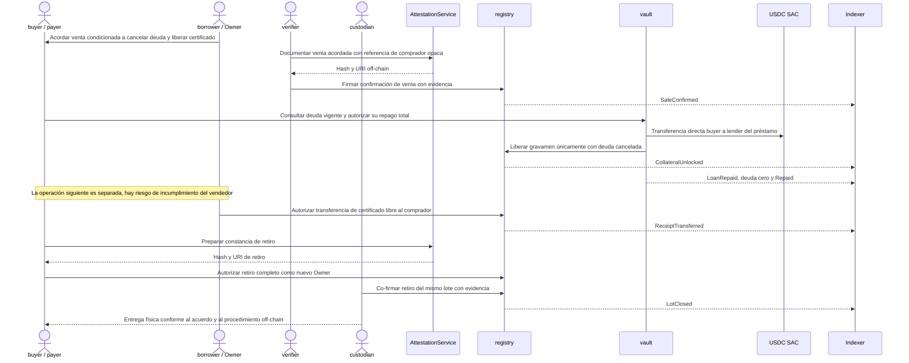
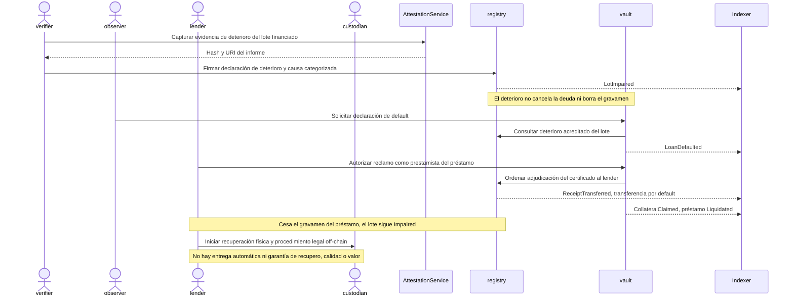
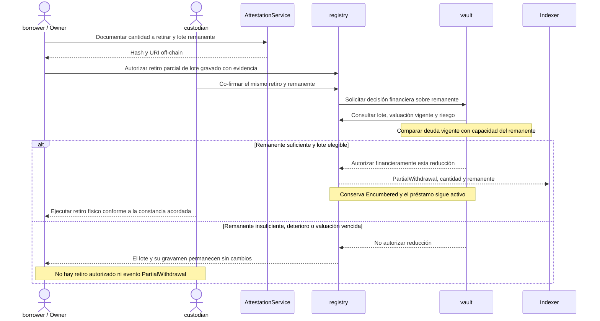
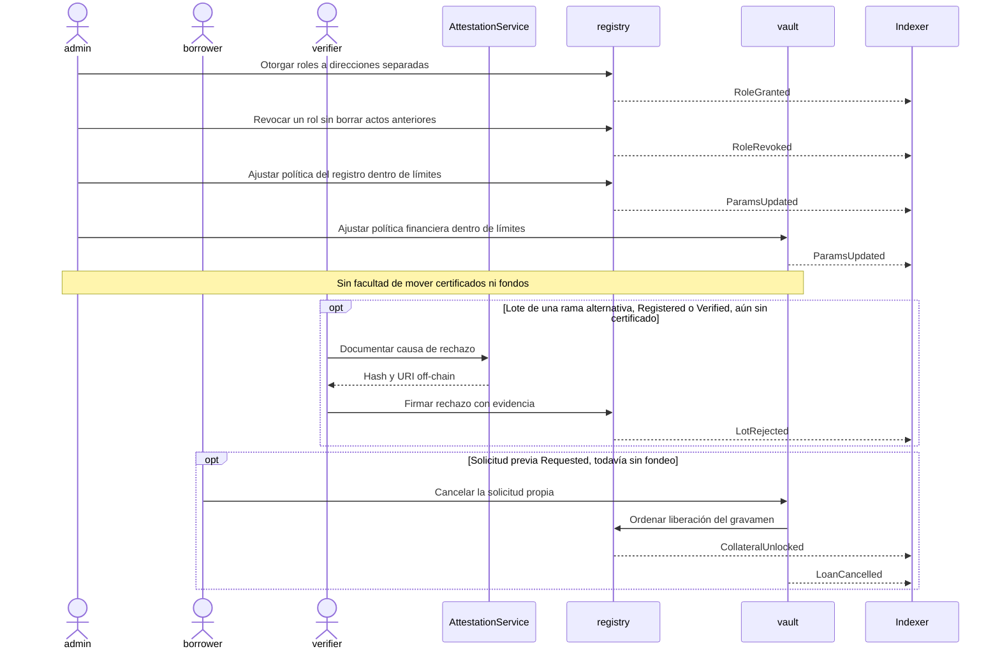
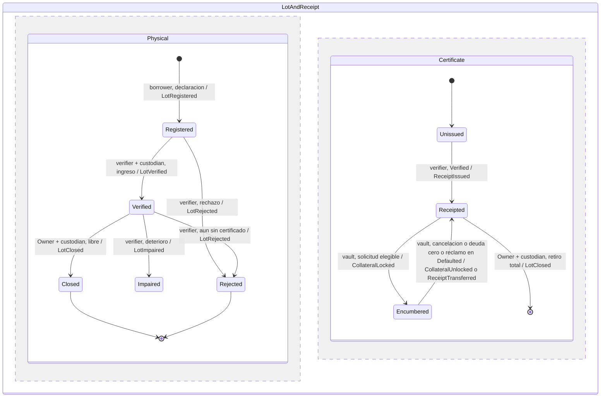
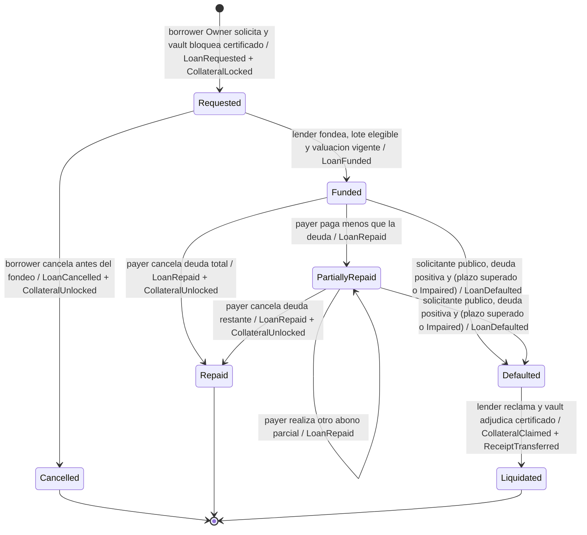

# Arquitectura de YerbaCapital

## 1. Resumen ejecutivo

YerbaCapital propone financiamiento colateralizado y trazabilidad para lotes de yerba canchada (*coarse-ground dried yerba*) del NEA —Misiones y Corrientes— durante su estacionamiento (*aging*).
El MVP se diseña exclusivamente para Stellar Testnet, Soroban, Freighter y USDC de prueba, sin fondos ni participantes reales.
**El token no es la yerba:** el certificado es un derecho condicionado sobre un lote verificado, segregado y custodiado; la cadena no garantiza su existencia, calidad, ubicación ni integridad física.
`registry` conserva roles, lotes, atestaciones, titularidad y gravámenes; `vault` decide sobre préstamos y ordena transferencias mediante el activo de liquidación.
Las evidencias permanecen off-chain; los hechos físicos se registran mediante firmas de los roles autorizados y hashes de evidencia.
La app consume clientes generados y un historial indexado; ni ella ni los servicios deciden permisos, deuda o liberación de colateral.
El diseño conserva ADR-001 a ADR-005; las dos propuestas de §19 explicitan vacíos que deben resolverse antes de implementar los casos afectados.

### Supuestos y estado del documento

- **Estado:** arquitectura objetivo, no descripción de capacidades ya desplegadas. El repositorio incorpora una base off-chain ejecutable: app Next.js, gateway local y servicio de evidencia con almacenamiento por hash. Los contratos, clientes generados, indexador y Freighter todavía no están implementados. ADR-006 documenta el bootstrap original; el avance ejecutable y su validación se registran en README.md y docs/handoff.md.
- **Fuentes internas:** [AGENTS.md](../AGENTS.md), especialmente §1.3, §3, §6, §7, §8.4, §8.5 y §11. [contract-spec.md](contract-spec.md) sigue siendo un espejo preliminar de §7; este trabajo no modifica su interfaz.
- **Supuesto S1:** la demo usa lotes, actores, documentos y valuaciones sintéticos. Los números de §12 son ilustrativos, no cotizaciones ni condiciones de crédito.
- **Supuesto S2:** cada lote tiene un custodio responsable, una identidad física segregada y un único certificado indivisible. No se fusionan lotes ni se fracciona su certificado en el MVP.
- **Supuesto S3:** la venta con deuda de §8b es una propuesta de liquidación por etapas, pendiente de adopción en §19. No se promete intercambio atómico entre dinero, certificado y mercadería.
- **Supuesto S4:** el deterioro físico y el gravamen son dimensiones independientes. Su representación definitiva debe reconciliarse con el estado combinado de AGENTS.md §7; §19 documenta la propuesta. Ninguna transferencia financiera acredita una recuperación física.
- **Supuesto S5:** para la demostración se publican los archivos sintéticos necesarios para verificar sus hashes. En un uso futuro, cualquier tercero puede comprobar integridad si obtiene lícitamente los archivos; la publicidad del hash no vuelve público el documento privado.
- **Supuesto S6:** no se modela una negociación de deuda después de `Defaulted`. Las condiciones de repago tardío, disputa y remediación se dejan a §17 y §18; el flujo de riesgo demostrado termina en el reclamo del certificado.
- Se distinguen reglas arquitectónicas, ejemplos y propuestas. Las propuestas no reemplazan decisiones aceptadas ni autorizan cambios silenciosos en la especificación.

## 2. Diagrama de contexto

Los roles son capacidades de direcciones, no certificaciones profesionales ni identidades legales. Un productor puede actuar como `borrower`; un molino que paga deuda de otro actúa como `payer`, sin convertirse por eso en `lender` ni en titular. INYM no firma ni opera el protocolo. La relación contractual entre actores queda off-chain.

## 3. Diagrama de componentes

La app accede a contratos únicamente mediante los clientes generados y la capa compartida de integración. El indexador lee eventos mediante RPC: no es un segundo cliente financiero ni firma por los usuarios. La flecha INYM indica evidencia contextual opcional, no una integración automática ni una determinación oficial del valor del colateral.

## 4. Componentes y responsabilidades

| Componente | Responsabilidad | Recibe | Produce | No hace | Persona dueña |
|---|---|---|---|---|---|
| `registry` | Autoridad sobre roles, identidad del lote, atestaciones, certificado y gravamen | Acciones autorizadas; hashes; datos mínimos del lote; instrucciones de gravamen de `vault` | Estado del lote y titularidad; registros de evidencia; eventos de trazabilidad | No calcula préstamos ni mueve USDC; no verifica la verdad material del informe | Contract Engineer |
| `vault` | Autoridad sobre préstamos, deuda, condiciones de riesgo y elegibilidad financiera de liberación | Autorización del titular, prestamista o pagador; estado y valuación de `registry`; tiempo del ledger | Estado financiero; deuda y capacidad de financiamiento; instrucciones a `registry` y al SAC; eventos financieros | No recibe un pool de depósitos, no custodia fondos de manera persistente ni ordena entregas físicas | Contract Engineer |
| USDC de prueba, SAC | Mantener saldos y ejecutar transferencias del activo configurado conforme a su autorización | Órdenes autorizadas de transferencia | Movimiento de saldo y evidencia de pago | No conoce lotes, intereses, gravámenes ni contratos de custodia | DevOps / Release Engineer, para selección y provisión; no es un contrato propio del equipo |
| Clientes generados y capa de integración | Vincular la app con las capacidades publicadas de los contratos y la red correcta | Especificación publicada; intención y autorización del actor | Lecturas contractuales y operaciones firmadas enviadas mediante RPC | No inventa reglas financieras ni una interfaz manual paralela | Integration Engineer |
| App web | Conectar actores con las capacidades permitidas y con el historial público | Lecturas contractuales; historial derivado; intención del usuario; referencias de evidencia | Solicitudes de operación y consultas | No decide permisos, deuda, titularidad ni confirmación financiera; no custodia claves | App Engineer; Integration Engineer es dueño de su frontera con Stellar |
| Freighter | Proveer firma explícita bajo control del usuario y contexto de red | Solicitud de autorización | Firma o rechazo | No atestigua hechos físicos ni decide solvencia | App Engineer, integración de billetera; Freighter es externo |
| Servicio de atestación | Recibir evidencia, conservar referencia y calcular SHA-256 | Archivos o paquetes sintéticos; contexto de lote y tipo de atestación | Hash y URI off-chain; relación verificable con el registro posterior | No reemplaza la firma del `verifier` o `custodian`, no certifica veracidad ni guarda sus claves para actuar por ellos | Oracle Engineer |
| Almacenamiento de evidencia | Preservar bytes y disponibilidad conforme a permisos | Archivos y manifiestos | Recuperación autorizada del mismo contenido | No convierte un archivo en hecho verificado ni garantiza disponibilidad eterna por usar IPFS | Oracle Engineer |
| Indexador e historial persistido | Construir y servir la cronología desde eventos confirmados | Eventos de `registry`, `vault` y pagos del SAC; referencias de evidencia | Historial por lote y préstamo, posición de sincronización y procedencia | No es fuente de verdad para decisiones financieras ni modifica el estado contractual | Oracle Engineer |
| Stellar RPC | Acceso técnico a la red para consulta, envío y lectura de resultados/eventos | Consultas y transacciones | Resultados y eventos de Testnet | Recibir una transacción no equivale a confirmar su ejecución; no constituye archivo histórico ilimitado | DevOps / Release Engineer, disponibilidad; Integration Engineer y Oracle Engineer, consumo |
| Stellar Expert | Inspección independiente y enlaces públicos de evidencia | Referencias públicas de contrato o transacción | Consulta del registro de Testnet disponible | No determina permisos ni existencia física; no es dependencia para liquidar un préstamo | DevOps / Release Engineer, referencias de evidencia |

**Responsabilidad única:** `registry` cambia la titularidad y el gravamen; solo admite instrucciones de gravamen o adjudicación provenientes de `vault`. `vault` decide sobre deuda, fondeo, repago y procedencia financiera del retiro. El SAC es el único que altera saldos de USDC. El titular puede transferir un certificado libre según las reglas de `registry`, pero no eludir un préstamo activo. `admin` no tiene ninguna vía de traslado de fondos o certificados.

El fondeo transfiere `lender → borrower`; el repago, `payer → lender`. `vault` coordina, sin balance común ni retención de fondos. El equipo debe identificar un único activo de liquidación de Testnet por despliegue y registrar su procedencia; un activo propio denominado USDC no es una emisión de Circle. El SAC permite utilizar activos emitidos de Stellar desde contratos; no sustituye la lógica de préstamo. [Fuente: Stellar Asset Contract](https://developers.stellar.org/docs/tokens/stellar-asset-contract).

## 5. Frontera on-chain / off-chain

Los datos mínimos públicos del protocolo se limitan a lo requerido para trazabilidad y financiamiento. La demo no incorpora información comercial real: las cantidades y valuaciones on-chain son sintéticas. Un uso futuro debe resolver expresamente la tensión entre trazabilidad pública y confidencialidad antes de incorporar datos reales.

| Dato | Ubicación | Motivo | Quién lo escribe |
|---|---|---|---|
| Identificador opaco del lote, commodity y referencia opaca del depósito | On-chain, `registry` | Vincular colateral y trazabilidad sin publicar identidades o ubicación exacta | `registry`, por declaración firmada del `borrower`; aceptación de custodia en verificación |
| Peso declarado, luego verificado; humedad y comienzo/método de estacionamiento relevantes al colateral | On-chain, `registry` | Evaluar elegibilidad y evolución del lote | `borrower` declara con evidencia; `verifier` acredita y el `custodian` co-firma el ingreso; posteriores cambios mediante atestaciones |
| Estado físico, titular y gravamen del certificado; préstamo vinculado | On-chain, `registry` | Evitar cambios de titularidad o liberaciones incompatibles | `registry`; el gravamen y la adjudicación solo por instrucción de `vault` |
| Roles y parámetros de política públicos | On-chain, contrato responsable | Autoridad verificable | Contrato correspondiente, por autorización de `admin` dentro de límites; roles en `registry` |
| Valuación del lote y momento de publicación | On-chain, `registry` | Base fechada para el financiamiento | `registry`, por publicación autorizada de `price_oracle` |
| Principal, tasa, vencimiento, pagos, deuda y estado del préstamo | On-chain, `vault` | Fuente de verdad financiera | `vault`, ante operaciones permitidas y tiempo del ledger |
| Saldos y transferencias USDC de prueba | On-chain, SAC | Evidencia independiente del pago | SAC, por órdenes autorizadas coordinadas por `vault` |
| Atestación, rol firmante, hash y tiempo de registro | On-chain, `registry` | Identificar autoría e integridad de una afirmación | `registry`, ante firma del rol competente y co-firmas cuando correspondan |
| Fecha observada del hecho físico | Off-chain, evidencia; tiempo de registro on-chain | Evitar confundir observación con incorporación al ledger | Capturante y firmante; el contrato acredita el momento de registro |
| Fotos, tickets de balanza, informes, acuerdos de depósito, venta y retiro | Off-chain | Tamaño, privacidad y contexto | Capturantes y responsables autorizados mediante el servicio de atestación |
| URI y relación entre archivos, hash, lote y transacción | Off-chain | Recuperación y auditoría sin publicar enlaces sensibles en cadena | Servicio de atestación; indexador vincula con el hash efectivamente registrado |
| Nombres, CUIT/DNI, teléfonos, datos bancarios, GPS exacto, condiciones comerciales privadas | Exclusivamente off-chain con acceso restringido; no se usan en la demo | Privacidad y confidencialidad | Responsables autorizados; nunca la app hacia la cadena |
| Origen pseudónimo y referencia de comprador | Compromiso/hash on-chain cuando corresponde; registro original off-chain | Vinculación sin identidad pública directa | Rol competente con evidencia; nunca un hash aislado de un dato personal de baja entropía |
| Metodología de valuación y referencias INYM | Off-chain | Contexto, no precio automático contractual | `price_oracle` documenta fuentes y supuestos |
| Línea de tiempo, búsqueda y posición de sincronización | Off-chain, historial derivado | Consulta pública eficiente y continuidad del histórico | Indexador, solo desde registros confirmados |
| Claves privadas | Billetera del usuario; fuera de cadena y de servicios | Control explícito de firma | Usuario; no se copian a repositorio, app o almacenamiento de evidencia |

El historial puede estar atrasado: la deuda y los permisos se consultan en contratos, sin tomar decisiones sobre la base de la copia indexada. Cada evento preserva procedencia: red, contrato, transacción, ledger y posición del evento. El indexador deduplica, conserva su avance y permite volver a procesar el historial disponible. Si perdió datos fuera de la ventana de RPC, los recupera de una copia verificable o informa la discontinuidad; no reconstruye hechos inexistentes desde el estado actual. RPC conserva una ventana acotada de eventos. [Fuente: Stellar RPC, eventos](https://developers.stellar.org/docs/data/apis/rpc/api-reference/methods/getEvents).

## 6. Actores, capacidades y co-firmas

La matriz expresa capacidades, no firmas técnicas. **CF** significa co-firma obligatoria. **Owner** significa titular actual del certificado, que puede dejar de ser el `borrower` original. **Payer** es quien autoriza usar sus propios fondos para pagar deuda ajena o propia; no es un rol administrativo nuevo. **Public** significa una acción sin rol privilegiado, sujeta a las condiciones del préstamo.

| Actor / rol | Registrar | Verificar | Emitir certificado | Valuar | Solicitar | Fondear | Repagar | Inspeccionar | Deteriorar | Retiro parcial | Confirmar venta | Declarar default | Reclamar colateral | Administrar roles |
|---|---|---|---|---|---|---|---|---|---|---|---|---|---|---|
| `admin` | — | — | — | — | — | — | — | — | — | — | — | — | — | Sí |
| `custodian` | — | CF con `verifier` | — | — | — | — | — | — | — | CF con Owner y aprobación de `vault` si hay deuda | — | — | — | — |
| `verifier` | — | CF con `custodian` | Sí | — | — | — | — | Sí | Sí | — | Sí | — | — | — |
| `price_oracle` | — | — | — | Sí | — | — | — | — | — | — | — | — | — | — |
| `borrower` | Sí | — | — | — | Si es Owner | — | Con fondos propios | — | — | Como Owner, CF con `custodian` y aprobación de `vault` si hay deuda | — | Public | — | — |
| `lender` | — | — | — | — | — | Con fondos propios | Como Payer | — | — | Solo si pasó a ser Owner y ya no hay gravamen | — | Public | Solo el del préstamo | — |
| `observer` / comprador | — | — | — | — | — | — | Como Payer, con firma propia | — | — | — | — | Public | — | — |

`borrower` y `lender` son posiciones económicas que cualquier dirección elegible puede asumir, no permisos de originación otorgados discrecionalmente por `admin`. Toda persona puede consultar los registros públicos. Declarar default es permissionless: no habilita a quien lo solicita a reclamar el certificado ni cambia por sí solo su titularidad. El guion usa `observer` como solicitante; `admin` no participa en los flujos de valor por su poder administrativo.

- Para cada lote, **`custodian ≠ verifier`, `custodian ≠ borrower` y `verifier ≠ borrower`**, no solo direcciones adyacentes distintas.
- AGENTS.md §8.5 también separa `price_oracle` de `custodian` y `verifier` para el mismo lote. La independencia económica del oráculo respecto del `borrower` requiere una política adicional; no se presume por la mera diferencia de direcciones.
- Un mismo actor económico con varias direcciones puede coludir: separación de claves no demuestra independencia de personas.
- El `verifier` confirma el ingreso físico con CF del `custodian`; el `borrower` solo declara el lote antes de esa verificación. La emisión de certificado la autoriza el `verifier` sobre lo previamente verificado.
- El retiro completo requiere Owner + `custodian`, certificado libre y evidencia. El parcial exige las mismas firmas y, si existe financiamiento activo, autorización financiera de `vault`; esa autorización no es una tercera firma humana.
- Solo Owner transfiere un certificado libre; el reclamo por default lo inicia el `lender` y lo ejecuta `registry` por instrucción exclusiva de `vault`.
- `admin` configura roles y parámetros acotados; no puede concederse una excepción financiera. Revocar un rol no borra sus atestaciones históricas ni cancela deudas.

## 7. Modelo de confianza

Las mitigaciones reducen riesgos; no los eliminan. La columna de producción es una agenda documental, fuera del MVP y sin afirmación de preparación operativa.

| Supuesto | Actor del que depende | Mitigación MVP | Mitigación para producción, solo documentada |
|---|---|---|---|
| El ingreso, peso y calidad declarados corresponden al lote | `verifier` y `custodian` | Co-firma, roles separados, evidencia sintética comprobable y autoría pública | Verificación independiente múltiple, acreditación, auditorías y responsabilidad contractual |
| El lote está segregado y permanece disponible | `custodian` | Identificador y etiquetas físicas de demo; evidencia de depósito e inspección | Acuerdos exigibles de custodia, seguros, inventarios e inspecciones sorpresivas |
| No se comprometió el mismo lote en otro sistema | `custodian` y `borrower` | Declaración respaldada, etiquetas y trazabilidad; unicidad solo dentro de este protocolo | Registros interoperables y controles legales/documentales; no hay solución puramente on-chain |
| La valuación es razonable y no está vencida | `price_oracle` | Publicación fechada, metodología off-chain, límites de financiamiento y bloqueo por antigüedad | Fuentes independientes, revisión de metodología y gestión de conflictos |
| Las claves representan a quien debía firmar | Cada firmante | Freighter, red Testnet, roles mínimos y evidencia de autoría | Gobierno y recuperación de claves, multifirma y supervisión de accesos |
| El administrador no abusa de la configuración | `admin` | Parámetros acotados, cambios registrados, ausencia de poderes de movimiento | Gobierno multifirma, demoras y revisión de cambios con impacto económico |
| La evidencia sigue disponible y no fue sustituida | Operador de evidencia | Hash de bytes exactos y copia sintética recuperable para la demo | Retención, redundancia, control de acceso y compromisos de disponibilidad |
| El historial consultado refleja la cadena | Operador de indexación y RPC | Procedencia de eventos, deduplicación, posición de sincronización y contraste contractual | Infraestructura redundante, preservación histórica y reconciliación independiente |
| El activo de liquidación es el configurado y transferible | Emisor del activo y operadores de red | Identificación explícita de USDC de prueba y confirmación de transferencias | Evaluación del emisor, restricciones y riesgo de contraparte; no se asume paridad absoluta |
| El titular puede ejercer derechos sobre la mercadería | Partes y custodio | Aclaración expresa de que el certificado de demo no constituye ejecución física | Estructuración legal, resolución de controversias y procedimiento de recuperación |
| El comprador cumple una venta por etapas | Comprador, vendedor y custodio | Caso sintético, exposición explícita a falta de atomicidad; sin entrega antes de liberar | Acuerdo de liquidación; cualquier escrow o mecanismo nuevo requiere ADR y revisión |

## 8. Flujos end-to-end

### Convenciones

Los diagramas muestran **interacciones de negocio**, no llamadas, firmas técnicas ni orden interno de ejecución. Las acciones on-chain de actores pasan por app, clientes generados, autorización en Freighter y RPC según §3; ese recorrido se omite repetidamente para legibilidad. Las líneas hacia `Indexer` representan publicación y consumo posterior de eventos confirmados mediante RPC, sin invocación directa entre contrato e indexador.

Una operación financiera y sus efectos contractuales dependientes deben confirmarse conjuntamente: no se acepta préstamo solicitado sin gravamen, fondeo sin transferencia, ni repago total sin liberar el gravamen correspondiente. Esa consistencia on-chain no hace atómica una entrega física. Los eventos listados representan hechos confirmados; un intento rechazado no emite un evento de negocio exitoso.

### 8a. Camino feliz: ingreso, financiamiento y liberación

### 8b. Venta del lote con préstamo vigente

**Diseño propuesto, no capacidad ya cerrada en la especificación.** Se parte de `Funded` o `PartiallyRepaid`, certificado `Encumbered` y lote no deteriorado. La confirmación de venta acredita un hecho documentado; no libera colateral ni acredita pago. En S3, el comprador puede pagar deuda del vendedor como `payer`; no es necesario agregar un nuevo rol. El precio privado, el saldo comercial y las obligaciones de entrega permanecen fuera del protocolo.

Si el pago es insuficiente, sigue habiendo gravamen y no se habilita el retiro ni la transferencia libre. La deuda puede cambiar entre la consulta y la confirmación; el importe de liquidación lo decide `vault`. La falla de una etapa posterior no revierte una anterior ya confirmada. No se promete protección de comprador equivalente a entrega contra pago ni se incorpora un mercado secundario. §19 propone adoptar o excluir este flujo; su ausencia no bloquea el camino feliz de la demo.

### 8c. Deterioro, default y reclamo del certificado

La transición `Defaulted → Liquidated` describe el reclamo del derecho condicionado, no el cobro de la deuda en dinero ni una venta física. El evento de transferencia registra al nuevo titular y la causa de default; no es una liberación por repago. La representación de deterioro simultáneo a gravamen y cambio de titularidad requiere resolver la propuesta de §19. Para default por plazo, se sustituye el informe de deterioro por vencimiento superado y deuda pendiente; el resto del reclamo es el mismo.

### 8d. Retiro parcial con préstamo vigente

La decisión de `vault` y la actualización autorizada en `registry` pertenecen a una misma operación on-chain; una aprobación vieja no sirve como permiso reutilizable. La valuación del remanente se escala proporcionalmente sin renovar su fecha de publicación. La logística nunca queda protegida por atomicidad con la cadena: custodio y titular deben documentar el retiro y conciliar lo autorizado con lo efectivamente entregado. Si hay una diferencia, se registra una nueva atestación; no se edita la historia. La convención temporal entre constancia, autorización y salida física se resuelve en §17/§18.

### 8e. Flujos auxiliares: administración, rechazo y cancelación

Incluidos para cubrir las alternativas del modelo y la procedencia de todo el catálogo, sin agregar requisitos al guion principal.

## 9. Máquinas de estado de alto nivel

### 9.1 Lote físico y certificado

Se muestran dos dimensiones concurrentes en un solo diagrama conceptual. **No prescribe dos estructuras ni sustituye la representación vigente en §7.** `Registered`, `Verified`, `Rejected`, `Impaired` y `Closed` describen el estado físico declarado/atestiguado; `Receipted` y `Encumbered` describen la situación del certificado. `Unissued` es una condición conceptual, no un nuevo estado exigido a la interfaz. La existencia de certificado no convierte la calidad física en inmutable.

Las dimensiones están correlacionadas: `Rejected` no admite emisión; `Closed` no conserva un certificado utilizable; `Encumbered` implica una solicitud o un préstamo pendiente sobre ese mismo lote. El diagrama concentra cambios de etapa. Una transferencia libre autorizada por Owner conserva `Receipted` y emite `ReceiptTransferred`. La vuelta desde `Encumbered` emite `CollateralUnlocked` si se cancela la solicitud o se paga la deuda total, y `ReceiptTransferred` si `vault` ejecuta el reclamo del `lender` en `Defaulted`. Una inspección de `verifier` conserva la etapa si no acredita deterioro y emite `InspectionRecorded`; una venta documentada por `verifier` emite `SaleConfirmed` sin cambiarla. Un retiro parcial autorizado por Owner + `custodian` y, si gravado, `vault`, emite `PartialWithdrawal` sin cerrar el lote. Una valuación de `price_oracle` sobre certificado emitido emite `ValuationPosted` sin cambiar gravamen. Estas operaciones cambian atributos e historial, aunque conserven el nombre de estado. La inspección no puede incrementar masa sin nueva verificación; cualquier pérdida se documenta y conserva el balance de masa.

`Impaired` impide nuevos fondeos, nuevas solicitudes y retiros parciales; **no elimina una deuda ni su gravamen**. Al reclamar, el certificado pasa al prestamista y queda sin el gravamen de ese préstamo, mientras la dimensión física continúa `Impaired`. El repago total de un préstamo deteriorado, si la especificación admite ese camino antes de default, libera el gravamen pero tampoco rehabilita el lote. No se permite nueva financiación de ese certificado por haber cambiado de dueño. La remediación y nueva verificación no se habilitan en esta entrega: su protocolo queda en §17. Esta separación motiva §19, propuesta B.

### 9.2 Financiamiento

El plazo se cuenta desde el fondeo, no desde la solicitud. En el baseline de AGENTS.md, el default por plazo exige que el vencimiento haya sido superado; no ocurre antes por una caída de precio sola. El deterioro habilita default anticipado de un préstamo efectivamente fondeado y con deuda. Si el lote se deteriora en `Requested`, no se fondea ni se declara deuda inexistente: queda pendiente de cancelación por el `borrower` y de las reglas de solicitudes bloqueadas a cerrar en §17. El mero transcurso del tiempo habilita la declaración; alguien debe promoverla.

El retiro parcial y la confirmación de venta no constituyen estados nuevos de préstamo. La venta de §8b utiliza el camino existente hacia `Repaid` y solo entonces la transferencia libre. `Liquidated` no acredita recupero monetario ni cancelación jurídica de todo reclamo residual; esa interpretación se define off-chain.

## 10. Catálogo de eventos de negocio

Se conservan los nombres de AGENTS.md §7.6. Son hechos de negocio, no un diseño de tipos, campos de interfaz o temas de publicación. **Todos** incluyen procedencia verificable: contrato emisor, red, transacción y orden en el ledger. Los eventos de hechos físicos llevan hash de evidencia y autoría; el URI se vincula fuera de cadena. Los datos listados son mínimos conceptuales, sujetos a conciliación de la especificación, sin información personal o comercial privada.

`Indexer`, `App` y `Auditor` son consumidores. `App` obtiene el historial mediante `Indexer` y confirma decisiones mediante contratos; `Auditor` contrasta la procedencia con la cadena. Los eventos de transferencia del SAC complementan los financieros, sin reemplazarlos ni contar un mismo pago dos veces.

| Evento | Cuándo ocurre | Actor que autoriza o desencadena | Datos de negocio que lleva | Emisor → consumidores | Flujo |
|---|---|---|---|---|---|
| `LotRegistered` | Declaración inicial, aún no verificada | `borrower` | Lote, titular declarado, custodio propuesto, commodity, cantidad declarada, depósito opaco, hash de evidencia declarada | `registry` → Indexer, App, Auditor | 8a |
| `LotVerified` | Ingreso y calidad acreditados conjuntamente | `verifier` + `custodian` | Lote, ambos autores, peso, humedad, referencia de estacionamiento, hash de evidencia de ingreso | `registry` → Indexer, App, Auditor | 8a |
| `LotRejected` | Rechazo antes de emitir certificado | `verifier` | Lote, autor, causa categorizada, hash del informe | `registry` → Indexer, App, Auditor | 8e |
| `ReceiptIssued` | Se crea el certificado único | `verifier` | Lote, titular, autor, vínculo a la verificación que lo respalda | `registry` → Indexer, App, Auditor | 8a |
| `ReceiptTransferred` | Cambia el titular, libremente o por reclamo | Owner, o `lender` mediante `vault` en default | Lote, titular anterior y nuevo, causa de transferencia, préstamo si corresponde | `registry` → Indexer, App, Auditor | 8b, 8c |
| `ValuationPosted` | Publicación o actualización de valor | `price_oracle` | Lote, valuador, valor en activo de liquidación, cantidad valorada y fecha de valuación | `registry` → Indexer, App, Auditor | 8a |
| `InspectionRecorded` | Se incorpora una observación del lote | `verifier` | Lote, autor, resultado categorizado, peso/humedad observados, pérdidas si las hay, hash de evidencia | `registry` → Indexer, App, Auditor | 8a |
| `LotImpaired` | Se acredita deterioro | `verifier` | Lote, autor, causa categorizada, hash de evidencia | `registry` → Indexer, App, Auditor | 8c |
| `PartialWithdrawal` | Se autoriza y registra reducción documentada | Owner + `custodian`; decisión de `vault` si gravado | Lote, autores, cantidad retirada, remanente, préstamo si aplica y hash de constancia | `registry` → Indexer, App, Auditor | 8d |
| `SaleConfirmed` | Se acredita venta documentada | `verifier` | Lote, autor, referencia opaca de comprador, hash de documentación; no precio comercial privado | `registry` → Indexer, App, Auditor | 8b |
| `LotClosed` | Retiro total documentado con certificado libre | Owner + `custodian` | Lote, autores, cantidad retirada y hash de constancia | `registry` → Indexer, App, Auditor | 8b |
| `CollateralLocked` | Se grava el certificado para una solicitud | `borrower`, con decisión exclusiva de `vault` | Lote, préstamo, titular y referencia de `vault` | `registry` → Indexer, App, Auditor | 8a |
| `CollateralUnlocked` | Cesa gravamen por cancelación o repago total | `borrower` cancela o `payer` repaga; decide `vault` | Lote, préstamo, titular, causa de liberación | `registry` → Indexer, App, Auditor | 8a, 8b, 8e |
| `LoanRequested` | Nace solicitud con certificado bloqueado | `borrower` Owner | Préstamo, lote, tomador, principal, tasa y plazo acordados | `vault` → Indexer, App, Auditor | 8a |
| `LoanCancelled` | Se cancela solicitud no fondeada | `borrower` | Préstamo, lote y tomador | `vault` → Indexer, App, Auditor | 8e |
| `LoanFunded` | Fondeo y transferencia fueron confirmados | `lender` | Préstamo, lote, prestamista, tomador, activo, principal, fecha y vencimiento | `vault` → Indexer, App, Auditor | 8a |
| `LoanRepaid` | Un pago se aplicó a la deuda | `payer` | Préstamo, pagador, prestamista, activo, importe, interés y capital imputados, saldo y situación resultante | `vault` → Indexer, App, Auditor | 8a, 8b |
| `LoanDefaulted` | Se declara incumplimiento procedente | Solicitante público; decisión de `vault` | Préstamo, lote, causa de default y deuda de referencia | `vault` → Indexer, App, Auditor | 8c |
| `CollateralClaimed` | Se adjudica el certificado al prestamista | `lender` | Préstamo, lote, prestamista adjudicatario y referencia al cambio de titularidad | `vault` → Indexer, App, Auditor | 8c |
| `RoleGranted` | Se otorga un rol administrativo del registro | `admin` | Dirección, rol y autoridad otorgante | `registry` → Indexer, App, Auditor | 8e |
| `RoleRevoked` | Se revoca un rol hacia adelante | `admin` | Dirección, rol y autoridad revocante | `registry` → Indexer, App, Auditor | 8e |
| `ParamsUpdated` | Cambia una política dentro de sus límites | `admin` | Componente responsable, política modificada, valores y momento de aplicación | `registry` o `vault` según política → Indexer, App, Auditor | 8e |

El inicio y fin de diagramas no agregan eventos distintos de los hechos que los originan. El fin de `Unissued` conceptual por rechazo no implica quemar un certificado inexistente. El cese del gravamen por adjudicación se evidencia conjuntamente con `ReceiptTransferred` y `CollateralClaimed`, sin confundirlo con un repago. La relación exacta entre eventos y atestaciones se termina de especificar en §17; el catálogo no renumera ni define una nueva interfaz.

## 11. Flujo de evidencia y oráculo físico

1. **Captura:** el actor competente documenta el hecho y la identidad física del lote: etiquetas de bolsas, ticket de balanza, medición de humedad, informe de inspección o constancia de retiro/venta. Capturar un archivo no verifica por sí solo el lote. Productor, cooperativa, secadero y laboratorio pueden aportar archivos; solo el rol autorizado acredita el hecho pertinente.
2. **Hash y conservación:** el servicio conserva los bytes y calcula SHA-256. Si hay varios archivos, el compromiso corresponde a un manifiesto reproducible que vincula sus hashes y contexto. Su formato definitivo corresponde a la especificación de evidencia, no a esta arquitectura. Devuelve hash y URI; el archivo original queda off-chain.
3. **Revisión y firma:** el firmante revisa contenido, lote, hecho y hash. Para ingreso firman `verifier` y `custodian` sobre el mismo compromiso; para retiros, Owner y `custodian`; para inspección, rechazo, deterioro y venta, `verifier`. La intención firmada se refiere al lote y al hecho concreto, no a un hash reutilizable sin contexto.
4. **Registro:** `registry` incorpora la atestación autorizada con su hash y emite el evento de §10. El borrador de ingreso del `borrower` queda explícitamente como declaración en `LotRegistered`, sin equivaler a `LotVerified`. La fecha del ledger acredita el registro; la evidencia puede indicar una fecha de observación anterior.
5. **Vinculación y consulta:** el indexador relaciona lote, evento, transacción, hash y URI. Un URI recibido del servicio sin atestación confirmada no constituye verificación ni estado financiero. Cambiar de ubicación el archivo puede cambiar el URI, pero no el hash del mismo contenido.
6. **Verificación independiente:** cualquier tercero con acceso al archivo o paquete calcula el hash de los mismos bytes, contrasta el compromiso on-chain, identifica al firmante y revisa su rol al momento de atestar. La verificación no depende de confiar en la base del indexador. Una discrepancia no se corrige sustituyendo el hash viejo; exige nueva evidencia y nuevo registro.

La evidencia pública de la demo es sintética y descargable. En un sistema real, privacidad y verificación se compatibilizan mediante acceso autorizado a documentos: integridad públicamente contrastable no significa acceso irrestricto a datos personales. No se publica un hash aislado de DNI, CUIT o ubicación fácilmente adivinable; los registros de origen se comprometen con contexto y protección contra enumeración. Un compromiso no anonimiza automáticamente información sensible.

El oráculo físico es el conjunto de actores, evidencia y autorizaciones que conecta observación con registro. No es un sensor en tiempo real ni una garantía de veracidad. El custodio tiene una obligación operativa de segregación y disponibilidad; el verificador acredita hechos; el oráculo de precio publica valoraciones. Son responsabilidades distintas.

## 12. Modelo conceptual de riesgo del colateral

### 12.1 Magnitudes y reglas

Para un lote, sean **V** la valuación vigente del peso actual en USDC de prueba, **h** el haircut total, **L** el límite LTV, **P** el capital pendiente, **r** la tasa anual simple y **Δt** el tiempo transcurrido expresado como fracción de año del ledger. Los porcentajes se comunican conceptualmente y se expresarán contractualmente en basis points según ADR-004.

- **Haircut total:** h = haircut base + ajustes por riesgo documentados. La cercanía a límites de humedad y una atestación abierta `MoistureDrift` pueden aumentarlo. No se inventa un precio nuevo desde la app.
- **Valor ajustado del colateral:** C = V × (1 − h).
- **Capacidad máxima:** M = C × L, redondeada hacia abajo en la unidad de liquidación elegida.
- **Interés de un intervalo:** I = P × r × Δt, con redondeo conservador hacia el prestamista. Se conserva interés devengado impago entre intervalos, sin capitalizarlo como nuevo principal.
- **Deuda vigente:** D = P + interés devengado pendiente. Cada repago se aplica primero a interés, después a capital. El próximo intervalo devenga sobre el capital realmente pendiente, no sobre el principal original ni sobre intereses.
- **LTV efectivo:** D / C. La solicitud no puede superar M; el fondeo vuelve a exigir elegibilidad y valuación vigente. El retiro parcial solo es admisible si D ≤ M del remanente.
- **Valuación del remanente:** V restante = V antes del retiro × proporción de peso que permanece. La reducción proporcional no hace más reciente a la valuación.
- **Balance de masa:** peso inicial verificado = peso actual + retiros acumulados + pérdidas registradas. No se aumenta peso por una inspección rutinaria ni se lo sustituye silenciosamente con otro lote.

`vault` es el único responsable del cálculo financiero. La valuación nominal y la calidad provienen de atestaciones de los roles competentes en `registry`. Una pérdida de peso documentada no puede dejar utilizable, sin ajuste, el valor atribuido a la cantidad anterior: la especificación debe cerrar la reconciliación de cantidad, valuación y fecha antes de otra decisión de fondeo o retiro. La app solo consulta resultados autoritativos; no envía un resultado calculado localmente para que se lo acepte como verdad.

La antigüedad máxima de la valuación bloquea fondeo y retiros parciales; la política final de elegibilidad al solicitar se termina en §17. Una valuación vencida no impide pagar deuda. Una caída de precio o un exceso de LTV por sí solos no crean un mecanismo de margin call, subasta o default anticipado en el MVP. El deterioro atestado sí bloquea nuevo fondeo y habilita default de deuda activa; no se vuelve financiable aumentando el haircut.

El activo financiable aparece después de la cadena hoja verde → sapecado → secado → canchado, durante el estacionamiento y antes de molienda y envasado. Como contexto productivo de AGENTS.md, el estacionamiento natural se considera de 6 a 24 meses y el acelerado de 30 a 60 días; la referencia de INYM allí citada habla de 9 meses o más. Son ventanas de proceso, no plazos de crédito impuestos por arquitectura.

El plazo debe ser coherente con el estacionamiento y la expectativa de salida del lote. El perfil natural admite una ventana más extensa que el acelerado; los plazos concretos, vigencias y umbrales de calidad se ratifican en la especificación. La duración del proceso productivo no garantiza que haya comprador al vencimiento.

### 12.2 Ejemplo sintético: lote de 12.000 kg

Se supone lote verificado con humedad del 5 %, valuación **V = 12.000 USDC de prueba**, haircut base **15 %**, sin ajustes y LTV máximo **60 %**. Son números de demostración, no referencias de mercado.

| Paso | Cálculo conceptual | Resultado ilustrativo |
|---|---|---|
| Valor ajustado | 12.000 × 85 % | C = 10.200 USDC de prueba |
| Capacidad máxima | 10.200 × 60 % | M = 6.120 USDC de prueba |
| Préstamo elegido | Principal menor o igual a M | P inicial = 5.000 USDC de prueba |
| Interés antes del primer pago | Tasa simple anual 12 %, intervalo de un cuarto de año | I = 150 USDC de prueba |
| Repago parcial | Abono de 1.150: primero 150 de interés, luego 1.000 de capital | P restante = 4.000; interés pendiente = 0 |
| Retiro de 2.000 kg inmediatamente después del pago | Remanente 10.000 kg; V restante = 12.000 × 10.000 / 12.000 | V restante = 10.000 USDC de prueba |
| Capacidad del remanente | 10.000 × 85 % × 60 % | M restante = 5.100; D = 4.000, retiro admisible si cumplen las demás condiciones |
| Retiro alternativo de 5.000 kg desde los 12.000 kg originales | Remanente 7.000; capacidad 7.000 × 85 % × 60 % | M restante = 3.570; D = 4.000, no admisible |
| Nuevo intervalo, después del retiro admisible | Otro cuarto de año al 12 % sobre capital pendiente de 4.000 | Interés adicional = 120; repago total de referencia = 4.120 |

El retiro alternativo es un escenario separado, no una segunda operación sobre el remanente de 10.000 kg. El ejemplo ignora tiempo adicional entre consulta y ejecución; el sistema siempre usa deuda al tiempo confirmado. Antes del primer pago, la deuda de 5.150 sigue por debajo de la capacidad original de 6.120; el fondeo no implica que esa relación permanecerá así.

Si aparece un ajuste de riesgo de 5 puntos porcentuales sin deterioro formal, h pasa a 20 % y la capacidad original baja a 5.760. Si se acredita `Impaired`, el problema no se resuelve con ese descuento: aplican las restricciones y la vía de default. La cuantía y activación exactas de ajustes quedan en §17.

El redondeo nunca debe permitir pedir o retirar por encima de la capacidad real: la capacidad se redondea hacia abajo y los intereses adeudados hacia arriba, sin cobrar dos veces lo ya devengado. La precisión, los puntos exactos de redondeo y el tratamiento de residuos corresponden a Smart Contract. No se transfieren excedentes por encima de la deuda por suponer un importe fijo de cierre.

## 13. Riesgos y mitigaciones

| Riesgo | Consecuencia | Mitigación demostrable en el MVP | Límite / pendiente |
|---|---|---|---|
| Físico: humedad, plagas, incendio, robo, inundación o pérdida de peso | Menor cantidad, calidad o disponibilidad de colateral | Inspección firmada, evidencia, balance de masa, deterioro y default con historial | La cadena no inspecciona ni reemplaza seguro o recuperación física |
| Oráculo físico: error o colusión | Certificado respaldado por afirmaciones falsas | Co-firma de ingreso, direcciones separadas y evidencia revisable | Diferentes claves no prueban independencia; auditoría y responsabilidad quedan fuera |
| Precio y obsolescencia | Sobreestimación de capacidad o deuda superior a recupero | Valuación fechada, haircut y límite LTV; no fondear ni retirar con valuación vencida | No hay liquidez garantizada, margin call ni subasta automática |
| Custodia y doble prendado fuera de cadena | Un mismo inventario respalda derechos incompatibles | Etiquetas y segregación de demo, constancia del custodio y exclusividad del certificado dentro de `registry` | No detecta gravámenes externos ni engaños entre sistemas |
| Claves de actores, oráculo o administrador | Atestaciones o configuración indebidas | Firma explícita, red correcta, privilegios limitados y revocación auditable | Rotación, continuidad de custodia y recuperación sin abuso requieren diseño posterior |
| Configuración administrativa | Política inconsistente o daño sobre contratos vigentes | Límites, historial de cambios y ausencia de poder de mover valor | Fijación de condiciones del préstamo y efecto prospectivo de cambios pendientes en §17 |
| Código o integración contractual | Movimiento incorrecto o gravamen inconsistente | Responsabilidades únicas, especificación y pruebas de autorizaciones y transiciones antes de demo | Arquitectura no equivale a auditoría; no hay fondos reales |
| Evidencia indisponible o privada filtrada | No se puede auditar el hash o se expone información | Archivos sintéticos, copia disponible, acceso separado y hashes de contenido | Un hash no restaura archivos; políticas de retención y protección deben definirse |
| Indexador desactualizado o histórico incompleto | Cronología incorrecta o apariencia engañosa de cancelación | Procedencia, deduplicación, progreso y consulta autoritativa al contrato | No inventar eventos faltantes ni ocultar lagunas |
| Operación de Testnet | Resets borran cuentas, contratos, transacciones e historial | Plan de redespliegue y reseeding sintético; evidencia identificada por red y despliegue | No asumir persistencia permanente ni confundir un reset con default |
| Emisor y activo de liquidación | Confusión entre activo propio y USDC de Circle; transferencias restringidas | Activo único identificado y prueba pública de fondeo/repago | Usar un nombre no acredita emisión, paridad ni convertibilidad |
| Legal: derechos sobre lote y ejecución | El recibo puede carecer de efecto exigible o no permitir entrega | Alcance de demo, derecho condicionado y recuperación expresamente off-chain | Negocio/Legal debe definir instrumento, custodia, jurisdicción y procedimiento |
| PSAV/CNV y AML/CFT | Actividades futuras pueden requerir encuadre y obligaciones | Sin onboarding real ni fondos reales; no se afirma cumplimiento | Evaluación especializada del rol de cada operador y normativa aplicable, fuera de esta arquitectura |
| Cambiario y descalce de unidades | Ingresos/costos en ARS y deuda expresada en activo estable pueden divergir | Valuación en activo del préstamo; ninguna conversión o salida a ARS | Sin off-ramp, cobertura ni equivalencia asegurada; evaluación futura de normativa cambiaria y tributaria |
| UX para actores no cripto | Firma de una operación o red equivocada; confusión entre certificado y mercadería | Identidad de red y autorización explícitas; separación conceptual de estado físico y financiero | Producto/UX define comprensión, recuperación de tareas y validación con usuarios |
| Venta por etapas | Comprador paga pero no recibe el certificado o la mercadería | Solo caso sintético, no atomicidad declarada y sin liberación por mera confirmación de venta | Propuesta A pendiente; garantías adicionales requieren otro diseño y evaluación legal |

Los resets de Testnet pueden borrar también transacciones y datos históricos; guardar un enlace no garantiza que siga disponible después del reset. Debe conservarse el paquete de evidencia sintética de cada demostración, sin presentarlo como un registro on-chain todavía vigente. [Fuente: Stellar, resets de redes de prueba](https://developers.stellar.org/docs/build/guides/basics/automate-reset-data).

El encuadre PSAV/CNV y las obligaciones AML/CFT se identifican como riesgo y tarea pendiente, sin concluir si este protocolo u operador queda alcanzado. Se consultaron el [régimen de PSAV de CNV](https://www.argentina.gob.ar/normativa/recurso/219405/texact-TituloXIV-CapIII/htm) y la [referencia de UIF sobre PSAV](https://www.argentina.gob.ar/node/427968) para delimitar esa revisión futura. No son una afirmación de cumplimiento ni una recomendación de operar.

## 14. Extensibilidad a otros commodities

| Capacidad genérica | Yerba canchada en MVP | Soja, arroz y algodón, solo diseño |
|---|---|---|
| Lote segregado, custodia y certificado único | Bolsas identificadas en noque o depósito; un perfil de calidad y origen por lote | Conservan identidad de lote y custodia; requieren reglas propias de segregación en silo, depósito o fardos |
| Atestaciones y evidencia | Ingreso, humedad, peso, inspección, retiro, venta y deterioro | Conservan el mecanismo de autoría y compromiso de evidencia, cambian atributos y pruebas del rubro |
| Perfil de calidad y unidades | Humedad y peso de canchada; método de estacionamiento | Grados, impurezas, humedad, rendimiento u otros atributos según commodity; masa y unidad comercial explícitas |
| Valuación y haircut | Valor del lote en activo de liquidación y riesgo de estacionamiento | Metodología, ajustes y vigencia adecuados a mercado, calidad y conservación del rubro |
| Financiamiento | Certificado bloqueado, fondeo, repago y reclamo | Misma relación certificado–préstamo si el derecho y la custodia son equivalentes; plazo y límites propios |
| Historia y balance de masa | Peso inicial, pérdidas y retiros | Conserva trazabilidad del remanente; no permite mezclas que borren genealogía |

La extensión es un perfil de dominio, no un cambio de nombre en el mismo lote. El algodón requiere definir fardos, calidad y unidad comercial; no se presupone que sus bandas sean las de un grano. La elegibilidad y valuación de un commodity nuevo deben acordarse con el responsable de dominio y legal antes de habilitarlo. El MVP admite únicamente `YERBA_CANCHADA`.

El ganado requiere otro módulo: cada animal tiene identidad individual, sanidad, mortalidad y movimientos que no se representan correctamente mediante peso agregado de un lote fungible. Una reducción de peso no equivale a una baja individual y la custodia cambia con sus movimientos. Puede reutilizar evidencia y financiamiento conceptual, pero no la identidad ni el ciclo físico del lote agrícola. Ninguna de estas extensiones se implementa en el hackathon.

## 15. Alcance del MVP y guion de demo

**Dentro:** registro de roles; lotes de canchada; co-firma de ingreso; certificado no fungible por lote; valuación fechada; solicitud con gravamen; USDC de prueba pass-through; repagos parciales y totales; inspección; deterioro y reclamo; historial público verificable; firma explícita mediante Freighter en Testnet. El retiro parcial se incluye como capacidad a demostrar adicionalmente después de cerrar su especificación. La venta de §8b se diseña, pero queda condicionada a propuesta A y no se suma como requisito a los diez pasos.

**Fuera:** mainnet, fondos o inversores reales, KYC/AML operativo, integración bancaria o con emisores de warrants, conversión USDC/ARS, seguros reales, gobernanza DAO, auditoría externa, pool/escrow, mercado secundario, fraccionamiento del certificado, sensores en tiempo real, otros commodities y ganado. Tampoco hay garantía de rendimiento, recupero o cumplimiento regulatorio.

| Paso de AGENTS.md §11 | Capacidad y referencia arquitectónica | Evidencia requerida al implementar, todavía no producida |
|---|---|---|
| 1. Otorgar roles | `registry`, direcciones separadas; §6 y §8e | Registros `RoleGranted` |
| 2. Registrar lote de 12.000 kg | Declaración del `borrower`; §8a | `LotRegistered`, datos sintéticos |
| 3. Verificar con humedad de 5 % | `verifier` + `custodian` sobre el mismo hecho; §8a y §11 | `LotVerified` y archivo contrastable |
| 4. Emitir certificado y valuar | `registry`, roles diferenciados; §8a | `ReceiptIssued`, `ValuationPosted` |
| 5. Solicitar dentro de capacidad y bloquear | `vault` decide; `registry` grava; §8a y §12 | `LoanRequested`, `CollateralLocked` coherentes |
| 6. Fondear y acreditar USDC | Transferencia `lender → borrower`; §4 y §8a | `LoanFunded`, transferencia SAC y enlace Testnet |
| 7. Inspeccionar a mitad del estacionamiento | Atestación de `verifier`; §8a y §11 | `InspectionRecorded`, hash y evidencia |
| 8. Repagar parcial, total y liberar | Deuda autoritativa y `vault → registry`; §8a | `LoanRepaid` en ambos casos, transferencias SAC y `CollateralUnlocked` |
| 9. Deteriorar segundo lote, default y reclamo | Segundo lote con su propio préstamo fondeado; §8c y §9 | `LotImpaired`, `LoanDefaulted`, `ReceiptTransferred`, `CollateralClaimed`; sin fingir recupero físico |
| 10. Consultar historia de ambos lotes | Indexador con procedencia y consulta pública; §5 y §10 | Línea de tiempo correlacionada con contratos, transacciones y hashes |

La arquitectura permite planificar los diez pasos; **no certifica que la demo ya los ejecute**. El paso 9 exige resolver la representación de deterioro y gravamen señalada en propuesta B. El despliegue, la generación de clientes y los hashes de operaciones reales de Testnet pertenecen a las siguientes tareas de implementación y release.

## 16. Criterios de aceptación de la arquitectura

Los checks indican revisión del documento, no aceptación de código ni de la demo. Los términos de implementación mencionados en §17 son únicamente temas delegados, por exigencia del alcance, sin diseño técnico de su solución.

- [x] Las únicas cercas de contenido técnico son diagramas Mermaid; no hay código, firmas de funciones, estructuras, claves de almacenamiento ni numeración de errores.
- [x] No se describen pantallas, componentes visuales ni estados de presentación.
- [x] Los siete principios aparecen en §1, §4–§6, §8c, §11, §13 y §15; todo se limita a Testnet.
- [x] ADR-001 a ADR-005 permanecen vigentes; no se cambia certificado, separación de contratos, pass-through, interés simple ni fuente de valuación.
- [x] Cada cambio de titularidad/gravamen corresponde a `registry`, cada decisión financiera a `vault` y cada cambio de saldo al SAC, según §4.
- [x] Cada hecho físico identifica firmantes, evidencia, compromiso on-chain y evento en §6, §10 y §11; la declaración inicial no se confunde con ingreso verificado.
- [x] `admin` solo aparece en configuración de §8e; no tiene transiciones de traslado de fondos o colateral.
- [x] La separación por pares entre `custodian`, `verifier` y `borrower` está explícita; también se conserva la de `price_oracle` prevista en AGENTS.md §8.5.
- [x] Los cuatro flujos requeridos están diagramados y son coherentes con las dimensiones y transiciones de §9; los supuestos y propuestas condicionantes están señalados.
- [x] Cada evento de §10 tiene flujo de referencia en §8; cada transición de negocio en §9 identifica su evento, incluso cuando conserva el nombre de estado.
- [x] Los diez pasos de demo tienen correspondencia verificable en §15, incluida la preparación del segundo lote financiado y el historial de ambos.
- [x] Las fronteras documentales están explícitas; §17 delega implementación y §18 delega producto/legal sin diseñarlos aquí.
- [x] Los nueve bloques Mermaid fueron renderizados con Mermaid CLI, sin errores de sintaxis; esta validación no sustituye la revisión semántica de las propuestas.

**Pendiente de aceptación del diseño:** adoptar o rechazar las propuestas A/B de §19 y reconciliar §7 de AGENTS.md con la futura especificación. No se considera resuelto ese trabajo por marcar los checks documentales.

## 17. Pendiente para la especificación del smart contract

Esta lista define preguntas para el Contract Engineer; **no aporta sus soluciones de implementación**. Los valores de referencia de AGENTS.md §7.5 siguen siendo el baseline, pero su ratificación y límites codificados corresponden a la especificación, no a este documento.

1. **Co-firma:** mecanismo de recolección de autorizaciones de `verifier` + `custodian`, y Owner + `custodian`: transacción multi-auth o dos pasos. Debe preservarse identidad del hecho y la evidencia; una aprobación parcial no equivale a verificación completa.
2. **Relación entre contratos:** importación de la interfaz de `registry` desde `vault` y reconocimiento de `vault` como único autorizante del gravamen, su liberación y la adjudicación por default. El retiro gravado exige una decisión financiera vinculada al retiro concreto.
3. **Representación numérica:** tipos, decimales, unidades definitivas de masa —kg o g— y dinero, precisión de tiempo, redondeo exacto, residuos, aplicación de pagos y prevención de duplicación de interés.
4. **Persistencia:** organización del storage, estrategia de TTL y restauración de entradas archivadas. Definir continuidad del acceso a derechos y deudas sin diseñarla desde arquitectura.
5. **Errores:** catálogo final y numeración estable, respetando el baseline y las reglas de evolución; no se enumeran aquí.
6. **Parámetros:** valores definitivos, límites codificados y alcance por commodity de LTV, haircut y ajustes, vigencia de valuación, bandas de humedad, peso mínimo, tasa máxima, plazo y período de gracia. No introducir default distinto del baseline al definir la gracia sin aprobación.
7. **Escrow:** confirmar su ausencia conforme a ADR-003. Cualquier caso con custodia de fondos, aun motivado por la venta, requiere un ADR nuevo antes de implementarse; no queda habilitado por este pendiente.
8. **Pausa:** mecanismo y alcance; qué nuevas operaciones bloquea y cómo preserva repago, consulta y derechos adquiridos. La referencia vigente permite pausar nuevos préstamos, no inmovilizar fondos a discreción.
9. **Estado físico y certificado:** resolver propuesta B y la discrepancia del diagrama combinado de §7 frente a `Impaired` con préstamo activo o ya reclamado; asegurar que liberar o adjudicar no cure el deterioro.
10. **Remediación:** determinar si se habilitará una nueva verificación de `Impaired`, con qué autorizaciones/evidencia y efectos sobre el gravamen. El diagrama vigente sugiere re-verificación, pero sus precondiciones detalladas solo cubren el ingreso inicial. No implementar una salida inferida.
11. **Default y pagos tardíos:** deuda positiva, préstamos elegibles, vencimiento y gracia; relación entre repago, declaración y reclamo si compiten; tratamiento de deuda residual y prohibición de doble recupero después de adjudicar.
12. **Venta:** adoptar o excluir propuesta A; precisar qué acredita `SaleConfirmed`, si puede repetirse y cómo se vincula a evidencia y préstamo sin publicar precio comercial privado. No convertir la confirmación en liberación automática.
13. **Retiros:** consistencia conjunta de decisión de `vault` y actualización de `registry`, fecha original de valuación del remanente, balance de masa y documentación de autorización frente a salida física efectivamente realizada. No confundir intención de retiro con una entrega ya probada.
14. **Solicitudes bloqueadas:** tratamiento de `Requested` que se deteriora, pierde elegibilidad o queda sin fondear; cancelación, eventual expiración y sus efectos sin adjudicar un préstamo nunca fondeado.
15. **Inspecciones y riesgo:** distinguir observaciones, pérdida de masa, deriva de humedad y deterioro formal; vigencia de ajustes, reconciliación de la valuación con pérdidas de peso y efecto de nuevas atestaciones. No habilitar aumentos de cantidad sin nueva verificación.
16. **Política y roles vigentes:** fijación de condiciones por préstamo, efecto prospectivo de parámetros y revocaciones, separación de roles por lote y continuidad si un custodio o verificador deja de estar habilitado.
17. **Evolución del catálogo:** correspondencia final de atestaciones y eventos, datos mínimos de auditoría y preservación de nombres existentes. Resolver explícitamente `ReceiptTransferred` junto a `CollateralClaimed` en el reclamo, sin fingir pago.
18. **Configuración y arranque:** autoridad inicial y enlace entre componentes de un mismo despliegue Testnet; selección inequívoca del activo. El arranque no introduce un nuevo evento de negocio sin especificación.

## 18. Pendiente para Producto/UX y para Negocio/Legal

### Producto/UX — App Engineer / Docs & Pitch

- Definir las tareas de cada actor usando la matriz de capacidades, diferenciando actor económico, dirección, rol, Owner y Payer.
- Resolver la experiencia de recolección de autorizaciones entre personas cuando Contract Engineer defina el mecanismo, sin trasladar permisos a la app.
- Definir cómo comunicar estado físico, certificado, deuda, carácter Testnet y diferencia entre declaración, verificación y recuperación efectiva.
- Definir tratamiento de consultas desactualizadas, indexación incompleta, firmas rechazadas, confirmaciones pendientes y reanudación de tareas sin duplicar pagos.
- Acordar cómo se consulta evidencia pública sintética y qué tratamiento requerirían documentos privados en un futuro; un URI no prueba disponibilidad ni veracidad.
- Diseñar la demostración de los diez pasos, la comprensión por actores no cripto y los criterios de accesibilidad/usabilidad, sin introducir cálculos financieros autoritativos en producto.
- Si se adopta propuesta A, explicar el riesgo de etapas no atómicas y la diferencia entre confirmar venta, pagar deuda, transferir certificado y recibir mercadería.
- Establecer documentación de metodología y evidencias de demo, sin afirmaciones de retornos, calidad garantizada o readiness de producción.

### Negocio/Legal — Docs & Pitch, con revisión profesional externa pendiente

- Definir naturaleza y exigibilidad del derecho condicionado: alcance del certificado, relación con el lote y límites frente a un warrant u otro instrumento legal.
- Acordar responsabilidades, segregación, prueba de no doble prendado y procedimientos del custodio; identificar al responsable de cada observación y discrepancia de inventario.
- Definir cuándo una salida física se considera autorizada y ejecutada, documentación necesaria y tratamiento de retiro que no se completa o difiere de lo registrado.
- Determinar procedimiento de default, adjudicación y recuperación física; deudas residuales, controversias, costos y prevención de doble recupero. La etiqueta `Liquidated` no decide esas consecuencias jurídicas.
- Evaluar conflictos de interés y colusión entre tomador, custodio, verificador y valuador; diferencia entre separación de direcciones e independencia económica.
- Evaluar el eventual encuadre de operadores, activos y actividades bajo PSAV/CNV, AML/CFT, protección de datos, obligaciones contractuales, cambiarias y tributarias antes de cualquier uso real.
- Definir resguardo, acceso y retención de documentos; no usar el carácter verificable del hash como justificación para publicar datos privados.
- Si se adopta la venta por etapas, definir acuerdos, riesgo del comprador que paga deuda ajena, saldo comercial y derechos de restitución/entrega; el MVP no provee garantías jurídicas o escrow.
- Ninguna de estas tareas implica habilitar mainnet, fondos reales, seguros operativos ni un proceso de cumplimiento dentro del hackathon.

## 19. ADRs propuestos

Las propuestas siguientes **no están aceptadas ni sustituyen ADR-001 a ADR-005**. Permanecen en este documento para revisión; solo al adoptarlas se les asignará número, se crearán sus archivos y se actualizará el índice de decisiones y la especificación mediante el proceso de AGENTS.md §6.4. No se modifican en esta entrega `AGENTS.md` ni `docs/contract-spec.md`.

### Propuesta A — Sale settlement without escrow

- **Contexto:** se exige diagramar venta con deuda, pero el baseline solo define confirmación de venta y permite que un tercero repague. No define liquidación comercial ni protección del comprador. ADR-003 excluye pool y custodia persistente.
- **Decisión propuesta:** para un caso sintético y fuera del guion mínimo, la venta se registra con evidencia; el comprador puede cancelar deuda como pagador; después el titular transfiere el certificado libre y el nuevo titular acuerda retiro con el custodio. Se usan capacidades ya previstas, sin agregar una garantía de intercambio atómico.
- **Consecuencias:** conserva pass-through y las autoridades de `registry`/`vault`, pero el pago previo expone al comprador al incumplimiento del vendedor. Las etapas posteriores no revierten pagos confirmados. Si ese riesgo no resulta aceptable, excluir la demostración de venta; cualquier entrega contra pago o escrow exige otra decisión y revisión, no una ampliación tácita.
- **Estado / decisión requerida:** propuesta pendiente de aceptación por Architect y responsables de producto/legal. §8b no se implementa hasta resolverla.

### Propuesta B — Preserve impairment across receipt lifecycle

- **Contexto:** AGENTS.md §7 combina estado físico y situación del certificado. El paso a `Impaired` no detalla cómo conserva un gravamen activo; la adjudicación se expresa desde `Encumbered` hacia `Receipted`, aunque el guion requiere reclamar un lote deteriorado. La recuperación y nueva verificación tampoco tienen precondiciones completas. Inferir que el reclamo borra deterioro contradice la separación entre derechos y hechos físicos.
- **Decisión propuesta:** mantener el estado físico independiente del gravamen y la titularidad a nivel de reglas de negocio. El deterioro preserva el vínculo al préstamo; el reclamo cambia Owner y cesa ese gravamen, pero no altera `Impaired` ni genera disponibilidad física. La representación técnica queda a Smart Contract.
- **Consecuencias:** permite el paso 9 de la demo sin perder trazabilidad ni habilitar nuevo fondeo de un lote deteriorado. Requiere reconciliar la máquina y sus precondiciones en §7 y la especificación, con pruebas de reclamo y liberación sin rehabilitación implícita. Puede afectar la futura interfaz, por lo que clientes y app deben derivarse de esa especificación conciliada.
- **Estado / decisión requerida:** propuesta pendiente de aceptación por Architect y Contract Engineer antes de implementar el camino de deterioro/default; el principio de que una transferencia no cura un daño físico sigue siendo obligatorio.

### Handoff

- Persona: Architect
- Changed: docs/architecture.md
- ABI change: no; catálogo conceptual y propuestas pendientes, sin interfaz implementada ni modificación del baseline
- Tests: nueve diagramas Mermaid renderizados sin errores; revisión de correspondencia entre eventos, flujos y estados; sin cambios de código ni pruebas financieras ejecutadas
- Evidence: validación documental local; sin despliegues, hashes de transacciones ni evidencia de demo creada
- Next owner: Contract Engineer — redactar y conciliar docs/contract-spec.md a partir de la sección 17; resolver propuesta B antes del flujo de riesgo
- Next owner: App Engineer / Docs & Pitch — tomar la sección 18 y las capacidades de §6 sin inferir firmas técnicas ni reglas financieras locales
- Open questions: aceptación o exclusión de venta por etapas; representación de deterioro y gravamen; co-firmas; liquidación de pagos tardíos y deuda residual; parámetros y pausa; documentación temporal de retiros; acceso y retención de evidencia; alcance jurídico del certificado
